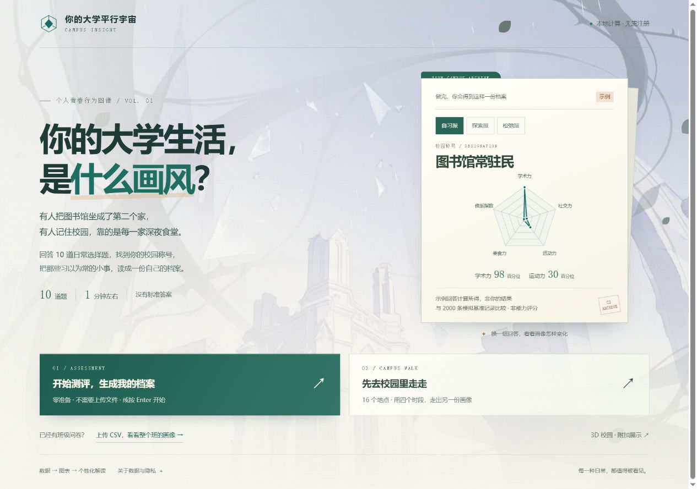
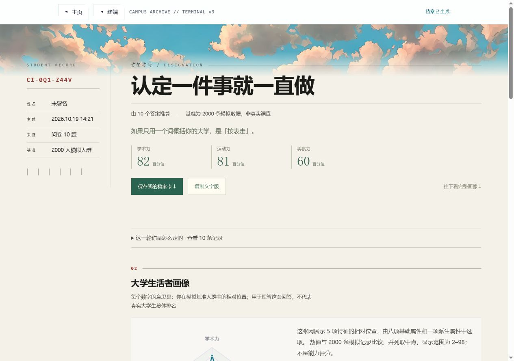

# 2026-10-19：首屏、结果成品与主线体验

本轮目标：让访客第一眼知道能得到什么，并能直接开始；完成后有能保存、能汇总的结果。所有改动位于原项目，本地开发地址为 `http://127.0.0.1:5174/`。未提交、未推送、未部署。

## 主要变化

| 页面 | 最终行为 | 目的 |
|---|---|---|
| 场景首屏 | 静态三层动漫场景，光雨与花瓣；主按钮立即开测，无须再经过介绍页 | 把等待改成直接参与 |
| 首屏 / 主页 | 左测评、右校园漫游，上传仍在下方工具区；展示可切换的三组示例 | 一眼看到入口和成品 |
| 示例档案 | 合法选项由正式报告函数计算，标明非用户结果；轻量 SVG，不加载 ECharts | 不用假数字吸引点击 |
| 答题 | 压缩状态栏与留白，1280×720 可见全部五个选项；保留暖色选择反馈 | 减少滚动和视觉干扰 |
| 个人报告 | 先显示称号、关键词和三项读数；保存 PNG、复制文字放在顶部 | 让结果值得留存 |
| PNG 档案卡 | 本机 Canvas 输出 1080×1350 图片，值与当前报告一致 | 无需截图或外部图像服务 |
| 班级画像 | 手机端三项统计并列；支持下载统计摘要和直接换 CSV | 更早看到图表，也能带走统计 |
| 数据导入 | 格式要求折叠；说明个人答题 CSV 的收集、合并方法；可下载现有格式示例 | 降低真实使用的准备成本 |
| 校园漫游 | 四区示意图、路线、即时增量、撤销、时段用尽后揭晓；手机固定结果入口 | 从文字列表变成可参与的规则探索 |
| 精灵 | 缩小桌面尺寸，气泡可关闭；修正日常台词中不准确的隐私与预测表述 | 保留角色气氛，让主任务更突出 |

## 功能修复与口径

1. **派生属性漏算**：账本仅保存八项基础属性。现在 `withDerivedAttributes()` 在报告边界重新计算派生维，问卷与账本不再出现同一输入、不同佛系指数的问题。
2. **地图行动数量混入问卷**：地图状态与侧栏序号只统计合法地点，十道问卷不会变成十次地图行动。
3. **第三次到访后还可点击**：衰减已经无增量时禁用按钮并给原因，避免第 4 次点击没有反馈。
4. **撤销地图行动**：逐项还原属性、标记和轨迹，时段随轨迹恢复；不撤销前面的问卷。清空地图行动同样保留问卷。
5. **地图档案编号**：包含实际属性，不再让不同地图结果共用同一个编号。
6. **探索前后对比**：明确是“问卷 + 行动增量”的变化，不包装成两次独立测量或对真实性的验证。
7. **返回与补答**：从班级画像补答后回到该班级；准备页可返回班级。主动回主页会清除补答去向，避免之后独立测评仍被带回班级。
8. **页面状态**：紧凑页头显示问卷测评、档案已生成、数据导入、群体分析，避免把旧账本的行动数当作班级样本数。
9. **固定元素**：页面转场只使用透明度，避免父级 transform 把手机固定操作栏和背景困在长页面底部。
10. **页面结构**：首屏、主页与报告避免嵌套 main；准备页有独立 h1。复制失败提供文字下载，PNG 失败保留其他导出方式。

## 验证记录

完整 `npm run check` 已通过，包含真实 production build、CSV 主线、负向输入、隐私扫描和新增体验回归。在线 AI 项明确未执行，不能把默认跳过写成线上验证通过。场景自检保留了一些历史推镜工具的兼容性检查，旧版 4.1 秒节拍不用于当前页面。

| 实际浏览器操作 | 结果 |
|---|---|
| 开发版与生产版：首屏 → 十题 → 个人档案 | 均走通 |
| 开发版实际文件选择：48 人示例 CSV → 群体画像 | 48 条有效、0 条剔除；学术型 12 人、25% |
| 生产版：使用同一示例文件 → 群体画像 | 结果一致 |
| PNG 保存、复制文字、班级统计摘要下载 | 实际下载与内容复核完成 |
| 作答两题后刷新，再进入问卷 | 恢复第三题，并显示恢复提示 |
| 问卷 → 地图 → 撤销 → 四步行动 → 报告 | 还原正确；原问卷保留；派生轴对比为同一口径 |
| 班级画像 → 补答 → 完成 | 回到原群体，并显示相似作答 |
| 320 / 390 / 1280 宽度下已查页面 | 无横向溢出；手机地图结果栏可见 |
| 生产页面浏览器错误日志 | 未见 error |

构建产物约 **3.54 MB**。无新增依赖，无新增公共位图素材。问卷字段、48 个合法答案、映射向量、基准文件与契约版本均未因这轮首屏改版改变。

## 文件位置

- 入口：`LandingContent.jsx`、`ProfilePreview.jsx`、`previewProfiles.js`、`landing.css`。
- 报告与导出：`ReportView.jsx`、`reportCard.js`、`cohortSummary.js`。
- 地图与状态：`CampusRoute.jsx`、`MapScene.jsx`、`mapEngine.js`、`useGameStore.js`。
- 页面与流程：`App.jsx`、`HubHud.jsx`、`QuizGate.jsx`、`UploadPanel.jsx`、`CohortPage.jsx`、`experience.css`。
- 回归：`scripts/test-survey-experience.mjs`，覆盖示例同源、撤销边界、地图计数、派生维与统计摘要隐私。

## 冲刺 90 分还不能省的部分

本轮改善用户体验、工程可靠性与结果闭环，不能据此认定比赛已达 90 分。真实在线模型调用、真实使用反馈、至少三条完整原始 Prompt 链、最终视频与 PDF 的个人信息及证据附件仍需补齐。当前 PDF 是技术底稿，不是完整提交包。

开发背景与需求来自用户当前对话；原交接文档仅作项目背景，未据此执行提交或部署。
